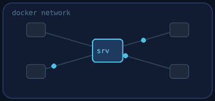
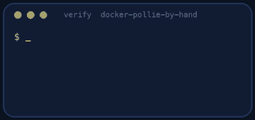

<p align="center"></p>

| | |
|-|-|
| **Time** | 90-105 min |
| **Cost** | free |
| **You need** | Docker running on your machine, git, a terminal |

## How this lab works

1. **Fork** this repository to your own GitHub account (button at the top right).
2. Clone **your fork** in your Ubuntu environment (WSL on Windows, your OrbStack machine on Mac).
3. Read the lab below (the same text is in [`LAB.md`](LAB.md)) and follow the mission.
4. Answer the questions in [`SUBMISSION.md`](SUBMISSION.md). Where a question asks for output, paste it in a code block. No screenshots needed.
5. Commit and push. Open the **Actions** tab of your fork (click *I understand my workflows, go ahead and enable them* the first time). The **Lab check** shows what is still missing.
6. When the check is green, **submit the URL of your fork** in the course platform.

> [!NOTE]
> The check only looks at your answers and any files the lab asks you to commit. Your instructor reads your work and may ask you to explain any line.

<p align="center"></p>

## 🎬 The situation

<p align="center"></p>

Your mentor pulls a chair over. *"The team moves Pollie to Docker Compose next week. Before that I want one engineer to know what Compose will do **for** us, so you will do it the hard way once: five containers, two networks, one volume, no orchestration. Three requirements came from security and operations. I will read them out, you build, and we talk when it breaks."*

- *"The database must not be reachable from anything that faces the user."*
- *"If someone deletes the containers, the polls must still be there when we bring it back."*
- *"We must be able to rebuild the whole thing from one script, and prove it."*

> [!IMPORTANT]
> **Your mission**
> - See with your own eyes how containers find each other (and when they cannot)
> - Run the full Pollie stack: web, API, worker, PostgreSQL and Redis, on two networks
> - Destroy the containers on purpose and prove the data survived
> - Take a backup that you could restore on another machine
> - Capture everything in `stack.sh` so the lab can check it by destroying and rebuilding your stack

**Time:** 90-105 min | **Cost:** free | **You need:** Docker running, git, a terminal. `./teardown.sh` removes the lab.

<p align="center"></p>

## Part 0 - Set the scene

Fork this repository, clone your fork, and run:

```bash
./setup.sh
```

It clones Pollie into `./pollie`, pulls the base images and builds the image you will run, `pollie:lab3`. You also get `nginx.conf` (ready to mount), `lab.env` (the settings for the Pollie containers) and a `stack.sh` that is empty: that one is yours.

The target picture:

```text
browser ──> pw-web (Nginx, :8080) ──/api──> pw-api ──> pw-db (PostgreSQL, volume pw-pgdata)
            [pw-frontend]            [both networks]  ├─> pw-redis <── pw-worker ──> pw-db
                                                      [pw-backend]
```

<p align="center"></p>

## Part 1 - How containers find each other

<p align="center"></p>

Do these with throwaway containers (names starting with `dns-`; teardown removes them).

1. On the **default bridge** network start two containers: `docker run -d --name dns-a alpine:3.20 sleep 3600` and the same for `dns-b`. From `dns-a`: `docker exec dns-a ping -c1 dns-b`. Read the error. Try the IP address instead (`docker inspect dns-b`).
2. Create your own network (`docker network create dns-net`) and start two more containers on it (`--network dns-net`). Ping by name again.
3. Look inside one of them: `docker exec dns-c cat /etc/resolv.conf`. What is the address of the name server?

> [!NOTE]
> **Predict** Will a container on `dns-net` be able to reach `dns-a` (default bridge) by IP address? By name? Check both.

> [!NOTE]
> **Think** Why does Docker not give names to containers on the default bridge? What does that mean for how you should always run multi-container applications?

<p align="center"></p>

## Part 2 - Build the stack by hand

Now the real thing. Run each container with `docker run` first (in a terminal, one at a time, checking the logs). When it works, write the same commands into `stack.sh`.

Fixed names (the verify script depends on them):

| Thing | Name |
|-------|------|
| Networks | `pw-frontend` (what the user's browser path touches), `pw-backend` (data) |
| Volume | `pw-pgdata`, mounted where PostgreSQL keeps its data (`/var/lib/postgresql/data`) |
| Containers | `pw-db`, `pw-redis`, `pw-api`, `pw-worker`, `pw-web` |

Rules:

| Rule | Hint |
|------|------|
| The database and Redis are on `pw-backend` only | `--network` |
| The web container is on `pw-frontend` only | |
| The API is on **both** | a container can join a second network with `docker network connect` |
| The worker is on `pw-backend` only and runs `python -m pollie.worker` | it uses the same image as the API |
| The database needs `POSTGRES_PASSWORD=devpass` and `POSTGRES_DB=pollie` | `-e` |
| The API and worker take their settings from `lab.env` | `--env-file` |
| `pw-web` is the only container with a published port: `127.0.0.1:8080` to port 80 | `-p` |
| `pw-web` mounts `nginx.conf` at `/etc/nginx/conf.d/default.conf` and the folder `pollie/web` at `/usr/share/nginx/html`, both **read-only** | bind mounts, `:ro` |
| Everything restarts after a reboot or crash, but not after you stop it | `--restart unless-stopped` |
| Label every container, network and volume with `lab=docker-pollie-by-hand` | teardown finds them by label |

The API and the worker will not start if PostgreSQL is not ready. Start the database first and **wait** for it (`docker exec pw-db pg_isready -U postgres -d pollie`).

> [!TIP]
> **Checkpoint** Open `http://localhost:8080`: Pollie loads. Create a poll in the browser and vote. Watch `docker logs -f pw-worker` while you do: the vote shows up there.

> [!TIP]
> **Stuck?** Create the networks and the volume *before* the containers. Remove old containers at the top of the script (`docker rm -f ... || true`) so you can run it again. A shell script that stops at the first error (`set -euo pipefail`) is easier to debug than one that ignores them.

<p align="center"></p>

## Part 3 - Prove the isolation

1. From the **API** container, can you reach the database? `docker exec pw-api python -c "import socket; socket.create_connection(('pw-db', 5432), 2); print('reachable')"`
2. From the **web** container? `docker exec pw-web nc -z -w 2 pw-db 5432; echo $?`. What does the error say? Is it "refused" or "cannot resolve"? Why?
3. `docker network inspect pw-backend`: which containers are on it? Do the same for `pw-frontend`.
4. `docker ps`: which ports does the host expose?

> [!NOTE]
> **Think** Nobody is attacking this stack. Why is it still better that the web container cannot even *resolve* the database's name? (Think about what happens when the web container is compromised.)

<p align="center"></p>

## Part 4 - Destroy it, keep the data

Create a poll called `Do not lose me` with a few votes. Then:

```bash
docker rm -f pw-web pw-api pw-worker pw-redis pw-db
docker ps -a          # empty
docker volume ls      # but pw-pgdata is still there
./stack.sh
```

Is your poll back?

> [!WARNING]
> **Break it** Repeat the experiment *without* the named volume. Start a throwaway PostgreSQL (`docker run -d --name dns-pg -e POSTGRES_PASSWORD=x postgres:16-alpine`), look at `docker volume ls` (an anonymous volume appeared!), create a table, `docker rm -f dns-pg`, start a new one. Is the table there? Where did the data go? (`docker volume ls` again; `docker volume prune` would delete it.)

<p align="center"></p>

## Part 5 - Back it up

A volume protects you from deleting a container, not from deleting the volume, a bad `UPDATE`, or a dead disk. Take a logical backup of the Pollie database with the tool PostgreSQL gives you, executed inside the container:

```bash
docker exec pw-db pg_dump -U postgres pollie > backup.sql
head -30 backup.sql
```

Commit `backup.sql`. Then prove it is restorable: create a fresh volume and database (`pw-pgdata-restored`, a throwaway container), restore with `psql`, and check the poll is there.

<p align="center"></p>

## Part 6 - Prove it

<p align="center"></p>

```bash
./verify.sh
```

It runs your `stack.sh` **twice** (it must be idempotent), inspects networks, mounts, ports and restart policies, tests isolation, sends a vote end to end, **destroys all containers**, rebuilds with your script and checks that the data survived. Fix what is red and run it again until it ends with **ALL CHECKS PASSED**.

<p align="center"></p>

## Level up (optional)

- Add a `HEALTHCHECK`-based wait to `stack.sh` instead of `pg_isready` loops: `--health-cmd` on the database and `docker inspect` to wait for `healthy`.
- Put the database password in a file and pass it with `--env-file` instead of `-e`. Is it better? What does `docker inspect pw-db` still show?
- Next lab you will replace `stack.sh` with a `compose.yaml`. Count the lines of each.

<!-- teardown:start (generated by labs.py, do not edit) -->
## Tear down (mandatory)

<p align="center"></p>

Resources left behind cost money, keep doors open and pollute the next lab. Removing what you created is part of the job, so it is part of the submission: **you must prove it is gone**.

Do this **last**, after you have pasted your `verify` output into `SUBMISSION.md` (once you tear down, the lab can no longer be verified).

1. Run `./teardown.sh`. It removes all `pw-*` containers, both networks, the `pw-pgdata` volume, the image `pollie:lab3` and the cloned source. Your `stack.sh`, `backup.sql` and answers stay.

Then run the proof:

```bash
./verify-teardown.sh
```

It prints a list of checks and must end with **TEARDOWN VERIFIED**. If it reports leftovers, remove them and run it again. Paste the full output in your submission.
<!-- teardown:end -->

<!-- submission:start (generated by labs.py, do not edit) -->
## 📬 Submission

Answer the questions in `SUBMISSION.md` in **your fork** (paste output in code blocks where asked), push, then submit the **URL of your fork**.

**Files to commit**

- `stack.sh`: the script that builds the whole stack from nothing, committed to the repo
- `backup.sql`: a `pg_dump` of the Pollie database, committed to the repo

**Questions to answer**

1. On the default bridge network two containers could not reach each other by name; on your own network they could. Paste both results. What does Docker run to make names work on user-defined networks, and what is the practical consequence for how you connect containers?
2. Paste `docker network inspect pw-backend` (the `Containers` part) and the two `nc` results from the web container (to the database and to the API). Why is it good that the web container cannot reach the database, even though nothing is "attacking" it?
3. You removed the database container with `docker rm -f pw-db`. Paste what happened to the polls (a) with the named volume and (b) in the experiment without one. What exactly is the difference between a named volume, a bind mount and an anonymous volume, and which of the three did you use for `nginx.conf`, for the database and for the throwaway experiment?
4. Why is `pg_dump` the right way to back up a running database, and copying the volume directory the wrong one? Paste the command you used and the first lines of `backup.sql`.
5. Why does only the web container publish a port, and what is the difference between `-p 8080:80` and `-p 127.0.0.1:8080:80`? What breaks if the API starts before the database is ready, and what did you do about it?
6. Writing `stack.sh` by hand: name three things that were repetitive or fragile. What would you want a tool to do for you instead?
7. Paste the output of `./verify.sh`. It must end with **ALL CHECKS PASSED**.
8. **Tear down.** Paste the output of `./verify-teardown.sh`. It must end with **TEARDOWN VERIFIED**.
<!-- submission:end -->
